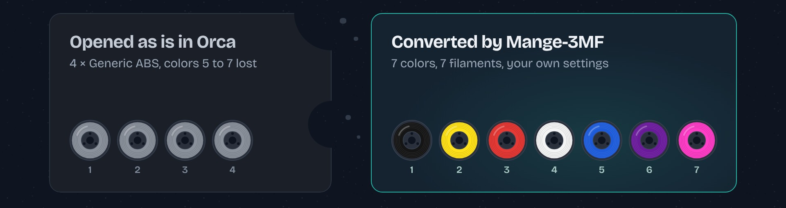
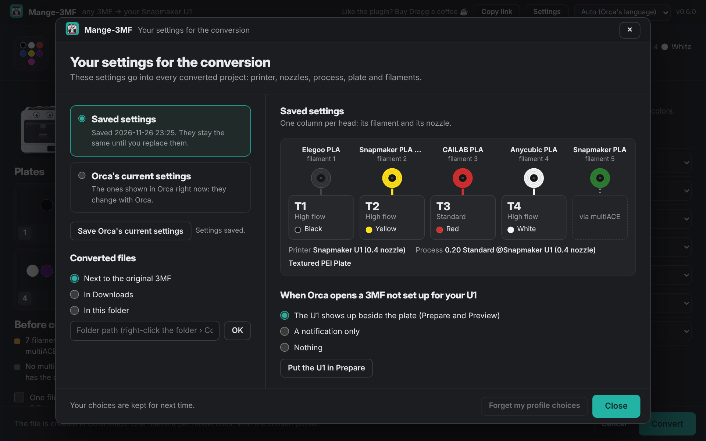
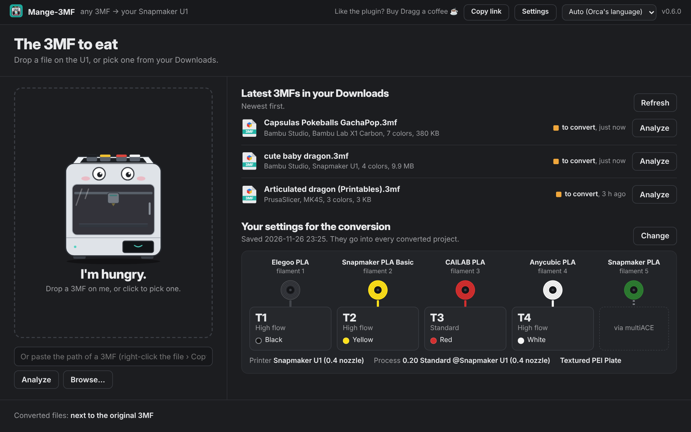
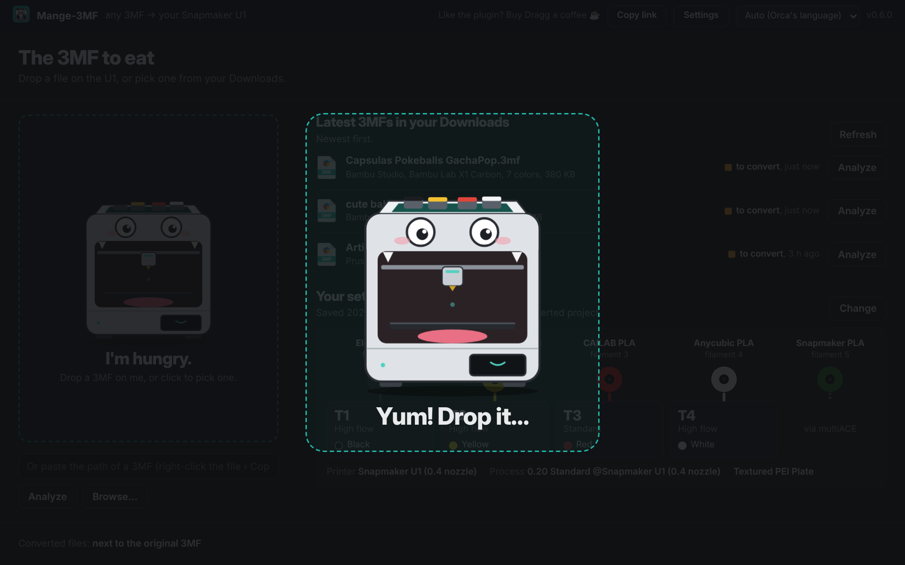
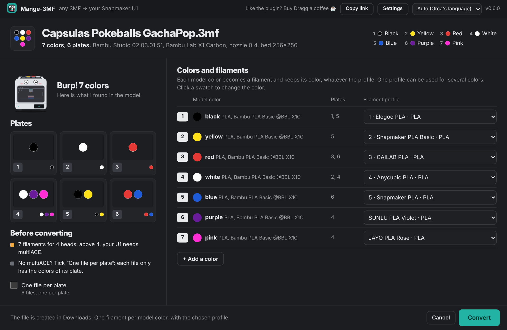
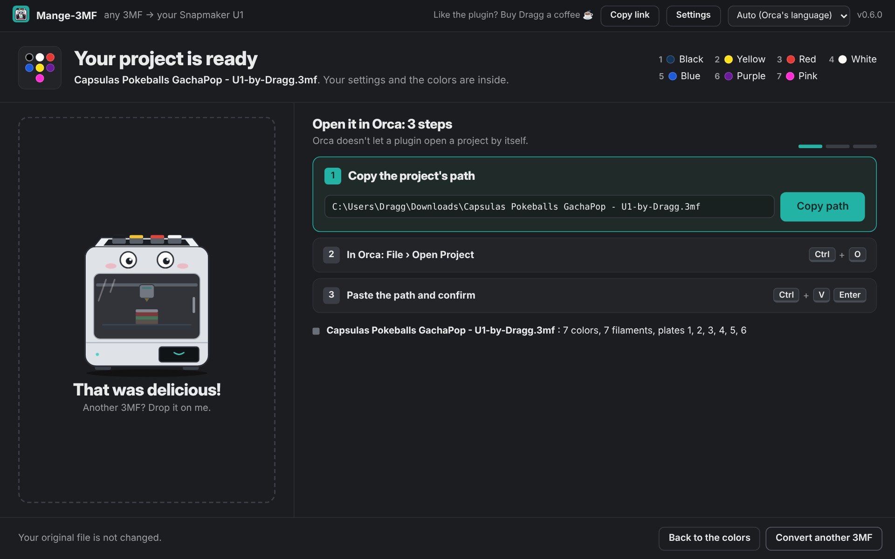
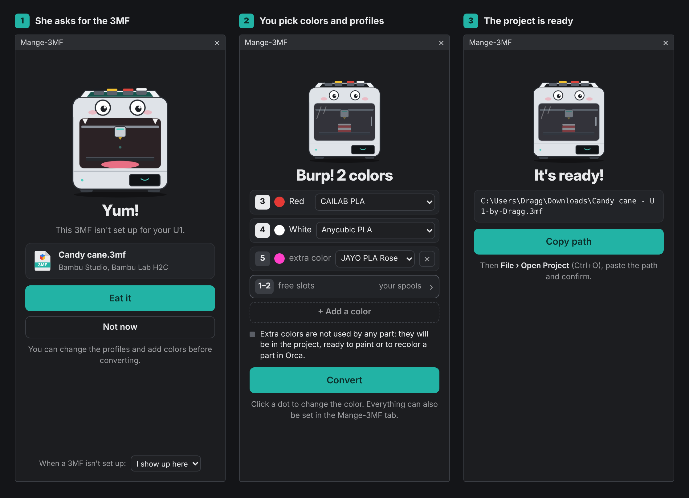

# Mange-3MF (Snapmaker U1) — user guide

> 🇫🇷 Version française : [LISEZMOI.md](LISEZMOI.md) · Overview: [README.md](README.md)

**Eats any 3MF and spits out an OrcaSlicer project ready for your Snapmaker U1.**
MakerWorld / Bambu Studio projects, Printables / PrusaSlicer, Snapmaker Orca, OrcaSlicer and its forks, plain 3MFs from CAD tools: exactly the model's colors (one filament per color), the painting and the plates are kept, and **your** settings are used.

- Version: **0.6.0** (2026-11-26) — see [CHANGELOG.md](CHANGELOG.md) (in French)
- For: OrcaSlicer 2.5 (Python plugins), Snapmaker U1 (4-head profile)
- Languages: English, French, German, Spanish, Italian (Orca's language by default, selectable in the tab)
- Author: Dragg with his friend Claude — GPL-3.0 license ([LICENSE](LICENSE))
- Community plugin, unofficial, not affiliated with Snapmaker, Bambu Lab or OrcaSlicer. **Use at your own risk**: always check the converted project before printing.
- Code, releases and bugs: [github.com/Dragg30000/mange-3mf](https://github.com/Dragg30000/mange-3mf)
- Like it? [Buy Dragg a coffee on Ko-fi](https://ko-fi.com/dragg) ☕

---

## Contents

1. [The problem](#1-the-problem)
2. [What the plugin does](#2-what-the-plugin-does)
3. [Install and update](#3-install-and-update)
4. [Use](#4-use)
5. [More than 4 colors](#5-more-than-4-colors)
6. [What is kept, replaced, removed](#6-what-is-kept-replaced-removed)
7. [Known limits](#7-known-limits)
8. [Troubleshooting](#8-troubleshooting)
9. [What's in the repository](#9-whats-in-the-repository)
10. [Support the project](#10-support-the-project)

---

## 1. The problem

When you open in OrcaSlicer a 3MF made with another slicer (Bambu Studio for MakerWorld, Snapmaker Orca…), the parts arrive but **not the colors or the settings**:

- the author's filaments are replaced by Orca's defaults: 4 slots (one per U1 head), for example 4 × "Generic ABS" in the same teal color. Everything shows in one color;
- a 7-color project loses the painting of colors 5 to 7, because Orca only keeps those 4 slots;
- the printer, nozzle and plate change too (for example the U1 with a 0.2 nozzle, a 0.10 process and the Cool Plate, hence the "ABS on Cool Plate" error);
- parts can move to another plate or off the bed.

Why: Orca only treats as its own the 3MFs signed by Bambu Studio or OrcaSlicer (Snapmaker Orca signs "Snapmaker_Orca"), and the author's settings (Bambu printer, Snapmaker profiles) don't match its U1 profile. So it falls back to its own defaults.

## 2. What the plugin does

Mange-3MF adds a **Mange-3MF tab** to OrcaSlicer, and a **panel beside the plate** (Prepare and Preview) where the U1 asks for the 3MFs that aren't set up for her ([§ 4.6](#46-the-u1-beside-the-plate)). It reads the original 3MF itself, **without going through Orca's import**, and builds a real OrcaSlicer project:

- **exactly the model's colors**: one file with all the plates and **one filament per color** (7 colors give 7 filaments). Nothing is split into several files, no color is merged;
- **colors**: the filament of each object and each part, the painting (renumbered filament by filament), modifiers, layer ranges, per-layer color or tool changes, per-feature filaments (walls, infill, supports…);
- **plates**: same plates, same names, same parts on them, placed on the U1 bed (same position if the bed is the same, otherwise the same position relative to the center, or centered if it doesn't fit);
- **settings**: yours (printer, High flow / Standard nozzles, process with the multiACE step, plate type), saved in one click from Orca. Nothing is taken from the author's settings;
- **filament profiles**: each color gets one of your profiles in the same material, the one with the closest color, with its High flow and Standard values. You can pick another one in the tab: one from your saved settings or **any of your Orca filament presets**. The values written are the current ones of the Orca preset with the same name, so Orca recognizes your presets when it opens the project;
- **colors**: the model's, or the one you pick for a filament;
- **PrusaSlicer projects** (Printables): parts, negative parts, modifiers, painting, per-layer color changes, layer ranges and the common per-object settings (walls, infill…) come along; **plain 3MFs** from CAD tools (Fusion, Onshape…) keep their colors (one color = one filament);
- **a material you don't have**: if the model wants PETG and none of your profiles is PETG, Orca's profile for your U1 is suggested, with a warning to check it;
- **remembered choices**: a profile you change by hand for a color comes back next time for the same color and material;
- **the author's supports**: your call, one tick keeps them (type, support filament), otherwise your settings apply;
- **filament order**: the colors closest to your current spools take their slots (1 to 4), the others follow.

The converted file is written next to the original (or in the folder you choose), for example `My model - U1-by-Dragg.3mf`. You then open it with **File › Open Project (Ctrl+O)**: an Orca plugin cannot open a project by itself.

## 3. Install and update

**From Orca Cloud** (easiest, with updates): in Orca's **Plugins** window, look for "Mange-3MF (Snapmaker U1)" among the Orca Cloud plugins and subscribe.

**By hand**:

1. Download `mange_3mf_any.py` (latest version on [GitHub › Releases](https://github.com/Dragg30000/mange-3mf/releases/latest)). In OrcaSlicer, open the **Plugins** menu. In the Plugins window: **Install a plugin › Install local plugin**, then choose `mange_3mf_any.py`.
2. Orca shows the permissions the plugin asks for; accept them:
   - read and write in your **Downloads** folder, to list the downloaded 3MFs and write the converted files there;
   - run **background threads**: the analysis and the conversion run in the background so Orca doesn't freeze.
3. The **Mange-3MF** tab appears at the end of the tab bar, after Prepare, Preview, Device…

**Update** (for example from 0.2.1): install the new file the same way. Orca warns that the plugin is already installed: choose to replace the old one. Version 0.1.0 was started from the Plugins window (▶ button); since 0.2.0 it is a tab.

For a 3MF stored outside Downloads, Orca asks for permission when the plugin reads it (and writes the converted file next to it).

## 4. Use

### 4.1 Save your settings (once)

Set Orca to your usual U1 settings: printer (0.4 nozzle, High flow / Standard per head), process, plate type and your filament profiles (as many as you like: they are the profiles offered for the models' colors). The easiest way: open one of your U1 projects. Then, in the Mange-3MF tab, click **Settings** at the top of the tab (or **Change** next to your settings), then **Save Orca's current settings**. The plugin keeps a copy of these settings and uses it for every conversion.

The tab's home shows them as on the printer: one card per head (T1 to T4) with its nozzle and its spool color, the extra filaments "via multiACE", then the printer, the process and the plate.

Do it again when your usual settings change. In the same window, you can also pick **Orca's current settings** instead of the saved ones.

Still in the Settings window, **Converted files** sets where they are written: **next to the original 3MF** (default), **in Downloads**, or **in this folder**: paste a folder path (in File Explorer: right-click the folder › "Copy as path"), then **OK**. The choice is kept and shown at the bottom of the home view. Orca may ask for permission to write in a folder outside Downloads. **Close** (or Esc) closes the window.

> Do it **before** opening a foreign 3MF in Orca: at that point, Orca's current settings are the author's project or Orca's defaults. The Settings window tells you so ("from the open project", "not a U1").

### 4.2 Pick the 3MF

- the home view lists the **latest 3MFs of your Downloads**, with their origin (Bambu Studio, Snapmaker Orca, OrcaSlicer…), their printer and their number of colors ("to convert" or "already for the U1"): click **Analyze** on the line;
- or **drop a 3MF** on the tab: the U1 drawn in "The 3MF to eat" opens its mouth, swallows it, chews during the analysis, then burps the model's colors (a file that is not a 3MF gets spat out). Clicking it opens a file picker. A click during the show skips it; animations stop if Windows is set to reduce animations;
- or paste the path of a 3MF under the U1 (in File Explorer: right-click the file › "Copy as path"), then **Analyze**;
- or **Browse…** (drag and drop and Browse: files up to 500 MB; a large file is read in pieces, the page shows "Reading … (3/7)");
- or **open it directly in Orca**: the U1 shows up beside the plate and offers to eat it ([§ 4.6](#46-the-u1-beside-the-plate)). If you chose "a notification", a **notification** offers "Prepare the conversion in the Mange-3MF tab" instead: one click starts the analysis, and a second notification tells you when it is ready. Then just open the tab (a plugin cannot bring its tab to the front by itself).

### 4.3 Analyze

During the analysis the U1 chews and the page tells you how far it is. Then the analysis replaces the home view:

- in the title, the file, its number of colors and plates, where it comes from (software, printer, nozzle, bed size) and its numbered colors;
- **Plates**: their thumbnail (or their colors) and their colors;
- **Before converting**: things to know (more than 4 filaments, mixed colors, unreadable painting…);
- **Colors and filaments**: for each filament, the model's color, the plates where it is used, and **the filament profile** used. The list has two parts: **In your settings** (the slots of your saved settings) and **Your presets** (all your Orca filament presets, in alphabetical order as in Orca, including those that are also in your settings; those made for another printer are listed apart). A warning shows when the profile's material is not the model's;
- **one profile can be used for several colors**: each filament keeps the model's color, whatever profile you pick;
- the **free slots** (the U1 slots the model doesn't use): their color and profile are up to you, like the other rows;
- **+ Add a color**: an extra filament in the project that the model doesn't use, to paint or recolor a part in Orca later (handy, as Orca doesn't let you add a filament to the project). By default, the next spool of your settings that isn't in the table yet; pick its color and profile, the cross removes it, 16 filaments at most per file. An extra color doesn't change the G-code as long as no part uses it;
- the **color swatch** of each filament: click it to pick another color ("color changed", with a link back to the model's color);
- the unused slots, when the model has fewer than 4 colors (Orca keeps at least one slot per head);
- the **One file per plate** box (under "Before converting"), if you prefer one file per plate, each with only its plate's colors;
- the **Keep the author's supports** box (when the project has supports): the author's support type and support / interface filaments (renumbered). Unticked, your support settings apply. Your profile and color choices stay when you tick or untick it, and the choice is kept for the next files;
- **Orca profiles**: when none of your profiles has a color's material (PETG, TPU…), the list also offers Orca's profiles made for your U1 in that material (group **Orca profiles**); the best one is picked by default and "Before converting" says so. Check its temperatures before printing;
- **"your choice from last time"** under a color: the profile you picked by hand for that color (same material, same or very close color) in an earlier conversion. Going back to the suggested profile forgets it; **Settings** › **Forget my profile choices** clears them all.

### 4.4 Convert and open

**Convert** (at the bottom of the tab, progress shows next to it) writes the file in the chosen folder ([§ 4.1](#41-save-your-settings-once)): by default next to the original 3MF (or in Downloads if it came from a temporary folder or from drag and drop). An existing file is never overwritten: `(2)`, `(3)`… are added to the name. **Cancel**, next to Convert, goes back to the home view without writing anything (it also works during the analysis).

The tab then shows **Open it in Orca: 3 steps**: **Copy path**, then in Orca **File › Open Project (Ctrl+O)**, paste the path (Ctrl+V) and confirm. Your settings and the colors are already in the project. At the bottom, **Back to the colors** reopens the analysis (to change a profile and convert again), **Convert another 3MF** goes back to the home view.

Before printing, check in Orca:

- the **filament profiles** if a warning "the model wants PETG…" is shown;
- the **prime tower**, placed where the author put it (moved like the parts);
- the position of the parts if a warning "too large for the U1 bed" is shown.

### 4.5 Language of the tab

The tab follows Orca's language: English, French, German, Spanish or Italian like Orca, English for other languages. The list at the top right of the tab (**Auto / Français / English / Deutsch / Español / Italiano**) lets you pick another one; the choice is kept. Everything switches at once, even the analysis on screen (the profiles you picked by hand are kept). Orca notifications and the names of per-plate files (`… - U1-by-Dragg - plate 2.3mf`, `… - U1-by-Dragg - plaque 2.3mf`, `… - Platte 2.3mf`…) follow too.

### 4.6 The U1 beside the plate

When Orca opens a 3MF that isn't set up for the U1 (a MakerWorld, Bambu Studio or Snapmaker Orca project…), the U1 shows up in a **panel to the right of the plate**, in Prepare and Preview (Orca only shows plugin panels there):

1. **"Yum!"**: she shows the file, where it comes from and its printer. **Eat it** starts the analysis with your saved settings (or Orca's current settings if none are saved). **Not now** puts her away.
2. **"Burp!"**: one row per filament, as in the tab. Click the swatch to change the color, and pick the filament profile among your settings and your presets. The **free slots** row opens to choose their filament; **+ Add a color** adds an extra color (the cross removes it). Warnings (material, more than 4 filaments…) show below. **Convert** writes the file in the folder chosen in Settings.
3. **"It's ready!"**: the file's path and **Copy path**, then **File › Open Project (Ctrl+O)**, paste the path and confirm.

The panel and the tab do the same work: an analysis started in the panel also shows in the tab, with what the tab has on top (plate thumbnails, One file per plate…), and what you change on one side shows on the other.

You can also **drop a 3MF on the panel** (or click "Drop a 3MF here" to pick one): same path, no need for the tab. Orca keeps the panel's place and size. The cross closes it; it comes back with the next 3MF that isn't set up for the U1.

Rather keep her in the tab? At the bottom of the panel, **When a 3MF isn't set up**: **I show up here** (default), **a notification** (as before 0.5.3) or **nothing**. The same choice is in the tab's **Settings** window, with the **Put the U1 in Prepare** button to bring her in right away. The panel needs OrcaSlicer 2.5.1 or later.

## 5. More than 4 colors

Orca accepts more filaments than heads on the U1: the converted project has one filament per color, and **Orca assigns the heads** when slicing, with your usual setting (automatic or manual assignment).

Above 4 filaments, Orca's G-code also uses `T4`, `T5`…: the printer must handle them, for example with the **multiACE** virtual toolheads, whose Preflight fetches the spools from the ACE units. Without that, tick **One file per plate**: each file only has its plate's colors (4 at most for most models).

Example: a set of Pokéball capsules in 7 colors on 6 plates (black; white; red; white + purple + pink; yellow + black; blue + red) gives **one file with 7 filaments** and 6 plates.

Two Orca limits:

- it keeps **at least 4 filaments** on the U1 (one per head). A 2-color model therefore has 4 slots, 2 of them unused: they stay your current spools;
- it can only **paint 16 filaments**: beyond that, the painting of colors 17 and up is lost (the analysis tells you).

Mixed colors (Snapmaker Orca Full Spectrum, Orca mixed filaments) become solid colors, each with its own filament.

## 6. What is kept, replaced, removed

| | |
|---|---|
| **Kept** | Geometry, objects and parts, negative parts, modifiers, support blockers / enforcers, color painting (renumbered), support, seam and fuzzy skin painting, layer ranges and variable layer heights, per-layer color / tool changes, per-object or per-part settings (walls, infill…), plate names, locking, print order per plate, spiral vase per plate, cuts, brim ears, model pictures and description (MakerWorld), prime tower position, the author's supports if you tick the box. |
| **Replaced by your settings** | Printer, nozzles, process, plate type. Filaments: one per model color, with one of your profiles (same material, closest color, your choice from last time, or the one you pick) or, when none has that material, an Orca profile for the U1; High flow / Standard variants included. |
| **Removed** | The author's thumbnails and G-code (Orca makes them again), the author's embedded profiles, filament / nozzle assignment specific to some printers (H2D), plate type per plate, filament order per plate, mixed colors from your settings. |

## 7. Known limits

- **Version 0.6.0**: tested outside OrcaSlicer (a real MakerWorld 3MF, a real PrusaSlicer project, Bambu Studio, PrusaSlicer, Snapmaker Orca and CAD projects built for the tests, Orca 2.5.1-style settings and presets with nozzle variants, a fake OrcaSlicer, the tab and the panel rendered in Chrome in English and French). Version 0.4.0 has run in a real Orca 2.5.1 (tab, analysis, clean profile names); so has 0.5.0 (new interface, analysis, profile choice), then the Prepare panel. Conversion with more than 4 filaments is still to be tried.
- **PrusaSlicer** projects: uncommon per-object settings (fuzzy skin…) are not carried over, a warning names them; resin (SLA) projects are refused. The PrusaSlicer conversion is still to be tried in a real Orca.
- **Already sliced** files (`.gcode.3mf`, `.bgcode`): refused, they don't contain the model.
- **Materials**: if neither your profiles nor Orca's profiles for your U1 have the model's material, the plugin warns you but doesn't create a profile.
- The **author's supports** are kept only if you tick the box; their line width, speeds and cooling stay yours.
- An Orca plugin **cannot open** a project (open the converted file with Ctrl+O) nor **bring its tab to the front** by itself.
- The **panel** only exists in Prepare and Preview, and Orca shows it in both: it can't be limited to one of them.

## 8. Troubleshooting

| Message or problem | What to do |
|---|---|
| "I need your U1 settings…" | Select your U1 and your profiles in Orca (or open one of your U1 projects), then **Settings** › **Save Orca's current settings**. |
| "the reference project must come from OrcaSlicer" | Version 0.2.0 or older: update to 0.2.1 or later (OrcaSlicer 2.5.1 signs its projects "BambuStudio-02.08.01.55"). |
| "Access denied by Orca: …" | The file is outside Downloads and the permission was refused. Put the file in Downloads, drop it on the tab, accept Orca's request, or manage permissions in the **Plugins** window (plugin details). |
| "File too large to be read here" | A file over 500 MB was dropped or picked with Browse: put it in Downloads or paste its path (no limit in those two cases). |
| "The file did not arrive in full" | Reading a dropped file was interrupted: drop it again. |
| The tab is in the wrong language | Pick it in the list at the top right of the tab (**Auto** follows Orca's language). |
| The U1 doesn't show up in Prepare | She only comes for a 3MF that isn't set up for the U1, and if **Settings** › "When Orca opens a 3MF not set up for your U1" is on "the U1 shows up beside the plate". If she is already chewing another 3MF, you get a notification. **Put the U1 in Prepare** (in Settings) brings her in. |
| "this OrcaSlicer can't show the panel" | You need OrcaSlicer 2.5.1 or later. Meanwhile, choose "a notification only" in **Settings**. |
| The panel takes too much room | Change its size or place: Orca keeps them. Or choose **a notification** or **nothing** at the bottom of the panel. |
| "PrusaSlicer project for a resin printer", "already sliced file" | See [§ 7](#7-known-limits). |
| A profile comes back by itself for a color | That's the remembered choices ("your choice from last time"): pick the right profile, it is remembered instead, or **Settings** › **Forget my profile choices**. |
| The tab doesn't show | Check in the Plugins window that Mange-3MF is loaded and enabled. With many plugin tabs, the last ones go into the ▾ menu at the end of the bar (the number of visible tabs is set in Orca's preferences). |
| Long profile names "…(a project.3mf)" | These are copies Orca makes when a project's settings differ from your presets. Since 0.4.0 the plugin writes the values of your Orca presets, so Orca recognizes them. To clean your saved settings, open one of your clean U1 projects (or pick your presets in Orca), then **Settings** › **Save Orca's current settings**. |
| "Folder not found" | The path pasted in **Settings** › **Converted files** doesn't exist: check it (no quotes, no file name at the end). |
| Odd colors or parts in the converted project | Open an [issue on GitHub](https://github.com/Dragg30000/mange-3mf/issues) with the link to the model (MakerWorld…) and a screenshot of the tab. The plugin logs errors in `erreurs.log`, in its storage folder (under `%APPDATA%\OrcaSlicer\orca_plugins\`). |

## 9. What's in the repository

| File | Role |
|---|---|
| `mange_3mf_any.py` | The plugin (the only file to install in Orca). |
| `README.md` | Overview (home page of the repository). |
| `GUIDE.md` | This user guide. |
| `LISEZMOI.md` | The same guide in French. |
| `CHANGELOG.md` | Version history (in French). |
| `docs/FONCTIONNEMENT.md` | Technical notes (3MF formats, painting, plates, color plan, project settings) to work on the code (in French). |
| `docs/captures/` | Screenshots of the tab (home, analysis, file ready, hungry U1, Settings window) and of the Prepare panel; English ones in `docs/captures/en/`. |
| `docs/visuals/` | Visuals for Orca Cloud and GitHub (banner, before / after, staged screenshots, the hungry U1 GIF). |
| `docs/visuals/logo/` | The logo: icon (SVG, 512 px PNG), mascot without background, wide logo for dark or light backgrounds, tab icon. |
| `tests/` | Automated tests (without Orca): `python tests/run_all.py`. See [tests/README.md](tests/README.md) (in French). |
| `LICENSE` | GPL-3.0 license. |

## 10. Support the project

Mange-3MF is free. If it saves you time, you can buy Dragg a coffee on **[Ko-fi](https://ko-fi.com/dragg)** ☕ (**Copy link** at the top of the tab). Feedback helps just as much: an [issue](https://github.com/Dragg30000/mange-3mf/issues) with the link to a model that converts badly, a screenshot, an idea.

---

⚠️ Beta software provided **as is, without any warranty** (GPL-3.0). **Use at your own risk**: always check the converted project before printing; the author cannot be held liable for any damage to the printer or the prints.
