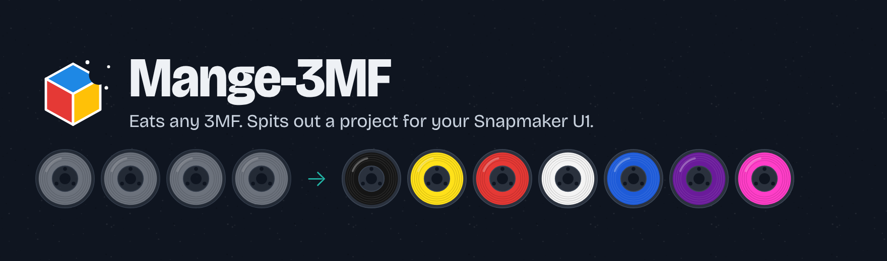
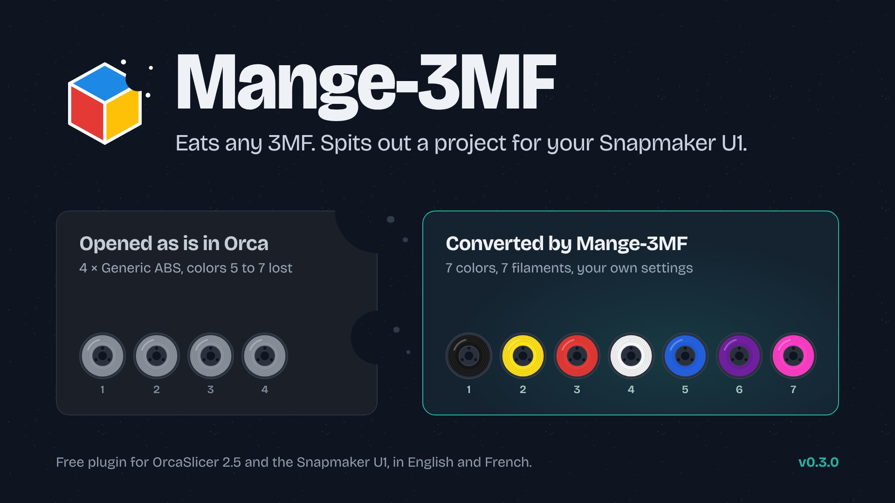
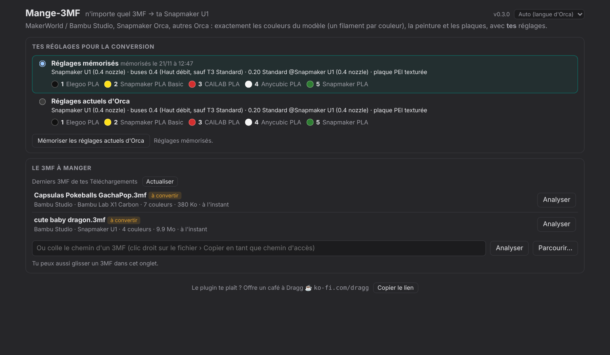
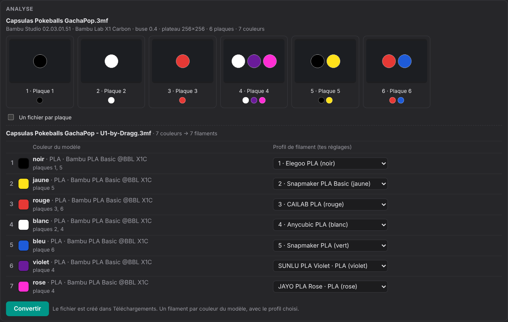
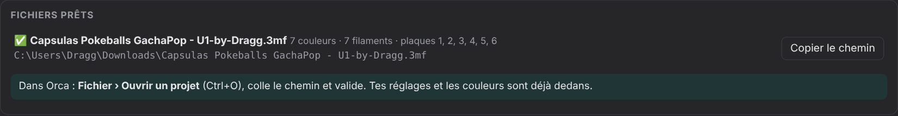

  
  
  
  
  
  

# Mange-3MF (Snapmaker U1) — plugin OrcaSlicer

> 🇬🇧 English: [README.md](README.md)

**Mange n'importe quel 3MF et le recrache en projet OrcaSlicer prêt pour ta Snapmaker U1.**
Projets MakerWorld / Bambu Studio, Snapmaker Orca, OrcaSlicer et ses variantes : exactement les couleurs du modèle (un filament par couleur), la peinture et les plaques sont gardées, et ce sont **tes** réglages qui sont utilisés.

- Version : **0.3.0** (21/11/2026) — voir [CHANGELOG.md](CHANGELOG.md)
- Pour : OrcaSlicer 2.5 (plugins Python), Snapmaker U1 (profil à 4 têtes)
- Langues : français ou anglais (la langue d'Orca par défaut, au choix dans l'onglet)
- Auteur : Dragg avec son ami Claude — licence GPL-3.0 ([LICENSE](LICENSE))
- Plugin communautaire, non officiel, sans lien avec Snapmaker, Bambu Lab ou OrcaSlicer. **À utiliser à tes risques et périls** : vérifie toujours le projet converti avant d'imprimer.
- Code, versions et bugs : [github.com/Dragg30000/mange-3mf](https://github.com/Dragg30000/mange-3mf)
- Le plugin te plaît ? [Offre un café à Dragg sur Ko-fi](https://ko-fi.com/dragg) ☕

---

## Sommaire

1. [Le problème](#1-le-problème)
2. [Ce que fait le plugin](#2-ce-que-fait-le-plugin)
3. [Installation et mise à jour](#3-installation-et-mise-à-jour)
4. [Utilisation](#4-utilisation)
5. [Plus de 4 couleurs](#5-plus-de-4-couleurs)
6. [Ce qui est gardé, remplacé, retiré](#6-ce-qui-est-gardé-remplacé-retiré)
7. [Limites connues](#7-limites-connues)
8. [Dépannage](#8-dépannage)
9. [Contenu du dossier](#9-contenu-du-dossier)
10. [Soutenir le projet](#10-soutenir-le-projet)

---

## 1. Le problème

Quand on ouvre dans OrcaSlicer un 3MF fait avec un autre logiciel (Bambu Studio pour MakerWorld, Snapmaker Orca…), les pièces arrivent mais **pas les couleurs ni les réglages** :

- les filaments de l'auteur sont remplacés par les valeurs par défaut d'Orca : 4 cases (une par tête de la U1), par exemple 4 × « Generic ABS » de la même couleur turquoise. Tout s'affiche de la même couleur ;
- un projet à 7 couleurs perd la peinture des couleurs 5 à 7, parce qu'Orca ne garde que ces 4 cases ;
- l'imprimante, la buse et la plaque changent aussi (par exemple U1 en buse 0.2, profil 0.10, Cool Plate, d'où l'erreur « ABS sur Cool Plate ») ;
- des pièces peuvent changer de plaque ou sortir du plateau.

Pourquoi : Orca ne reconnaît comme « ses » projets que les 3MF signés Bambu Studio ou OrcaSlicer (Snapmaker Orca signe « Snapmaker_Orca »), et les réglages de l'auteur (imprimante Bambu, profils Snapmaker) ne correspondent pas à son profil U1. Il prend alors ses propres valeurs par défaut.

## 2. Ce que fait le plugin

Mange-3MF ajoute un **onglet « Mange-3MF »** à OrcaSlicer. Il lit le 3MF d'origine **sans passer par l'ouverture d'Orca** et fabrique un vrai projet OrcaSlicer :

- **exactement les couleurs du modèle** : un seul fichier avec toutes les plaques et **un filament par couleur** (7 couleurs donnent 7 filaments). Rien n'est découpé en plusieurs fichiers, aucune couleur n'est fusionnée ;
- **couleurs** : filament de chaque objet et de chaque pièce, peinture (renumérotée filament par filament), modificateurs, plages de couches, changements de couleur ou d'outil par couche, filaments par fonction (parois, remplissage, supports…) ;
- **plaques** : mêmes plaques, mêmes noms, mêmes pièces dessus, replacées sur le plateau de la U1 (même position si le plateau est le même, sinon même position par rapport au centre, ou centrées si ça déborde) ;
- **réglages** : les tiens (imprimante, buses Haut débit / Standard, profil de traitement avec l'étape multiACE, type de plaque), mémorisés d'un clic dans Orca. Rien n'est repris des réglages de l'auteur ;
- **profils de filament** : chaque couleur prend un de tes profils, de la même matière, celui dont la couleur est la plus proche, avec ses réglages Haut débit et Standard. Tu peux en choisir un autre dans l'onglet ;
- **ordre des filaments** : les couleurs qui ressemblent le plus à tes bobines actuelles prennent leurs cases (1 à 4), les autres suivent.

Le fichier converti est écrit à côté de l'original, par exemple `Mon modèle - U1.3mf`. Tu l'ouvres ensuite avec **Fichier › Ouvrir un projet (Ctrl+O)** : un plugin Orca ne peut pas ouvrir un projet lui-même.

## 3. Installation et mise à jour

**Depuis Orca Cloud** (le plus simple, avec les mises à jour) : dans la fenêtre **Plugins** d'Orca, cherche « Mange-3MF (Snapmaker U1) » parmi les plugins d'Orca Cloud et abonne-toi.

**À la main** :

1. Télécharge `mange_3mf_any.py` (dernière version sur [GitHub › Releases](https://github.com/Dragg30000/mange-3mf/releases/latest)). Dans OrcaSlicer, ouvre le menu **Plugins**. Dans la fenêtre Plugins : **Installer un plugin › Installer un plugin local**, puis choisis `mange_3mf_any.py`.
2. Orca affiche les droits demandés par le plugin, accepte-les :
   - lire et écrire dans ton dossier **Téléchargements**, pour lister les 3MF téléchargés et y écrire les fichiers convertis ;
   - lancer des **fils d'exécution** : l'analyse et la conversion tournent en arrière-plan pour ne pas figer Orca.
3. L'onglet **« Mange-3MF »** apparaît au bout de la barre d'onglets, après Préparer, Aperçu, Appareil…

**Mise à jour** (par exemple depuis la 0.1.0) : installe le nouveau fichier de la même façon. Orca prévient que le plugin est déjà installé : choisis d'écraser l'ancien. La 0.1.0 se lançait depuis la fenêtre Plugins (bouton ▶) ; depuis la 0.2.0, c'est un onglet.

Pour un 3MF rangé ailleurs que dans Téléchargements, Orca te demandera l'autorisation au moment de le lire (et d'écrire le fichier converti à côté).

## 4. Utilisation

### 4.1 Mémoriser tes réglages (une seule fois)

Mets Orca sur tes réglages habituels de la U1 : imprimante (buse 0.4, Haut débit / Standard par tête), profil de traitement, type de plaque et tes profils de filament (autant que tu veux : ce sont les profils proposés pour les couleurs des modèles). Le plus simple : ouvre un de tes projets U1. Puis, dans l'onglet Mange-3MF, clique **« Mémoriser les réglages actuels d'Orca »**. Le plugin enregistre une copie de ces réglages et s'en sert à chaque conversion.

À refaire quand tu changes de réglages habituels. Tu peux aussi choisir, pour une conversion, **« Réglages actuels d'Orca »** au lieu des réglages mémorisés.

> Fais-le **avant** d'ouvrir dans Orca un 3MF venu d'ailleurs : à ce moment-là, les réglages actuels d'Orca sont ceux du projet de l'auteur ou ses valeurs par défaut. L'onglet l'indique (« viennent du projet ouvert », « pas une U1 »).

### 4.2 Choisir le 3MF

- l'onglet liste les **derniers 3MF de tes Téléchargements**, avec leur origine (Bambu Studio, Snapmaker Orca, OrcaSlicer…), leur imprimante et leur nombre de couleurs (« à convertir » ou « déjà pour la U1 ») : clique **Analyser** sur la ligne ;
- ou **glisse un 3MF** dans l'onglet ;
- ou colle le chemin d'un 3MF (dans l'Explorateur : clic droit sur le fichier › « Copier en tant que chemin d'accès ») ;
- ou **Parcourir…** (glisser-déposer et Parcourir : fichiers jusqu'à 80 Mo) ;
- si tu ouvres directement dans Orca un 3MF venu d'ailleurs, une **notification** propose « Préparer la conversion dans l'onglet Mange-3MF ». Un clic lance l'analyse, et une deuxième notification te dit quand elle est prête : il ne reste qu'à ouvrir l'onglet (un plugin ne peut pas l'afficher tout seul).

### 4.3 Analyser

L'analyse s'affiche en haut de l'onglet. Elle montre :

- l'origine du fichier (logiciel, imprimante, buse, taille du plateau) ;
- les plaques avec leur vignette et leurs couleurs ;
- le fichier qui sera créé et, pour chaque filament : la couleur du modèle, les plaques où elle sert, et **le profil de filament** utilisé (une liste de tes profils : change-le si besoin). Une alerte s'affiche si la matière du profil n'est pas celle du modèle ;
- les cases qui ne servent pas, quand le modèle a moins de 4 couleurs (Orca garde au moins une case par tête) ;
- la case **« Un fichier par plaque »** si tu préfères un fichier par plaque, chacun avec les seules couleurs de sa plaque ;
- les points à savoir (couleurs mélangées, peinture illisible…).

### 4.4 Convertir et ouvrir

**Convertir** (le message de suivi s'affiche juste en dessous) écrit le fichier à côté du 3MF d'origine (ou dans Téléchargements s'il venait d'un dossier temporaire ou d'un glisser-déposer). Un nom déjà pris n'est jamais écrasé : `(2)`, `(3)`… sont ajoutés.

Ensuite dans Orca : **Fichier › Ouvrir un projet (Ctrl+O)**, colle le chemin (bouton « Copier le chemin ») et valide. Tes réglages et les couleurs sont déjà dans le projet.

Avant d'imprimer, vérifie dans Orca :

- les **profils de filament** si un avertissement « le modèle veut du PETG… » est affiché ;
- la **tour d'essuyage**, posée à la place choisie par l'auteur (déplacée comme les pièces) ;
- la position des pièces si un avertissement « trop grande pour le plateau de la U1 » est affiché.

### 4.5 Langue de l'onglet

L'onglet suit la langue d'Orca : en français si Orca est en français, en anglais sinon. La liste en haut à droite (**Auto / Français / English**) permet d'en choisir une autre ; le choix est gardé. Tout passe dans la nouvelle langue tout de suite, même l'analyse affichée (les profils que tu as choisis à la main sont gardés). Les notifications d'Orca et les noms des fichiers par plaque (`… - U1 - plaque 2.3mf`, `… - U1 - plate 2.3mf`) suivent aussi.

## 5. Plus de 4 couleurs

Orca accepte plus de filaments que de têtes sur la U1 : le projet converti a un filament par couleur, et c'est **Orca qui attribue les têtes** au tranchage, avec ton réglage habituel (attribution automatique ou manuelle).

Au-delà de 4 filaments, le G-code d'Orca utilise aussi `T4`, `T5`… : l'imprimante doit savoir les traiter, par exemple avec les têtes virtuelles de **multiACE**, dont le Preflight va chercher les bobines dans les ACE. Sans ça, coche **« Un fichier par plaque »** : chaque fichier n'a que les couleurs de sa plaque (4 au plus pour la plupart des modèles).

Exemple : des Pokéballs en 7 couleurs sur 6 plaques (noir ; blanc ; rouge ; blanc + violet + rose ; jaune + noir ; bleu + rouge) donnent **un fichier de 7 filaments** et 6 plaques.

Deux limites d'Orca :

- il garde **au moins 4 filaments** sur la U1 (un par tête). Un modèle à 2 couleurs a donc 4 cases, dont 2 inutilisées : elles restent tes bobines actuelles ;
- il ne sait **peindre que 16 filaments** : au-delà, la peinture des couleurs 17 et plus est perdue (l'analyse le signale).

Les couleurs mélangées (Full Spectrum de Snapmaker Orca, filaments mixtes d'Orca) deviennent des couleurs pleines, chacune avec son filament.

## 6. Ce qui est gardé, remplacé, retiré

| | |
|---|---|
| **Gardé** | Géométrie, objets et pièces, pièces négatives, modificateurs, bloqueurs / forceurs de supports, peinture de couleur (renumérotée), peinture des supports, de la couture et de la peau floue, plages de couches et hauteurs de couches variables, changements de couleur / d'outil par couche, réglages par objet ou par pièce (parois, remplissage…), noms des plaques, verrouillage, ordre d'impression par plaque, mode vase par plaque, découpes, oreilles de bordure, images et description du modèle (MakerWorld), position de la tour d'essuyage. |
| **Remplacé par tes réglages** | Imprimante, buses, profil de traitement, type de plaque. Filaments : un par couleur du modèle, avec un de tes profils (même matière, couleur la plus proche, ou celui que tu choisis), variantes Haut débit / Standard comprises. |
| **Retiré** | Vignettes et G-code de l'auteur (Orca les refait), profils embarqués de l'auteur, répartition filaments / buses propre à certaines imprimantes (H2D), type de plaque par plaque, ordre des filaments par plaque, couleurs mélangées de tes réglages. |

## 7. Limites connues

- **Version 0.3.0** : testée hors d'OrcaSlicer (vrai 3MF MakerWorld, projets Bambu Studio et Snapmaker Orca fabriqués pour les tests, réglages façon Orca 2.5.1 avec variantes de buse, faux OrcaSlicer, onglet rendu dans Chrome en français et en anglais). L'onglet et l'analyse de la 0.2.0 ont tourné dans un vrai Orca 2.5.1 ; la conversion à plus de 4 filaments reste à essayer.
- Fichiers **PrusaSlicer** (Printables) : pas encore gérés. Orca les ouvre déjà en gardant la forme et la peinture.
- Fichiers **déjà tranchés** (`.gcode.3mf`) : refusés, ils ne contiennent pas le modèle.
- **Matières** : si aucun de tes profils n'a la matière du modèle (PETG, TPU…), le plugin te prévient mais ne crée pas de profil.
- Les **supports de l'auteur** (filament d'interface choisi dans son profil) ne sont pas repris : ce sont tes réglages de supports qui s'appliquent.
- Un plugin Orca **ne peut pas ouvrir** de projet (le fichier converti s'ouvre avec Ctrl+O) ni **afficher son onglet** tout seul.

## 8. Dépannage

| Message ou souci | Que faire |
|---|---|
| « Il me faut tes réglages U1… » | Choisis ta U1 et tes profils dans Orca (ou ouvre un de tes projets U1), puis « Mémoriser les réglages actuels ». |
| « le projet de référence doit venir d'OrcaSlicer » | Version 0.2.0 ou plus ancienne : passe à la 0.2.1 (OrcaSlicer 2.5.1 signe ses projets « BambuStudio-02.08.01.55 »). |
| « Accès refusé par Orca : … » | Le fichier est hors de Téléchargements et l'autorisation a été refusée. Mets le fichier dans Téléchargements, glisse-le dans l'onglet, accepte la demande d'Orca, ou gère les droits dans la fenêtre **Plugins** (fiche du plugin). |
| « Fichier trop gros pour être lu ici » | Mets le fichier dans Téléchargements ou colle son chemin. |
| L'onglet n'est pas dans la bonne langue | Choisis-la dans la liste en haut à droite de l'onglet (**Auto** suit la langue d'Orca). |
| « fichier PrusaSlicer », « déjà tranché » | Voir [§ 7](#7-limites-connues). |
| L'onglet n'apparaît pas | Vérifie dans la fenêtre Plugins que Mange-3MF est chargé et activé. S'il y a beaucoup d'onglets de plugins, les derniers passent dans le menu ▾ au bout de la barre (le nombre visible se règle dans les préférences d'Orca). |
| Couleurs ou pièces bizarres dans le projet converti | Ouvre une [issue sur GitHub](https://github.com/Dragg30000/mange-3mf/issues) avec le lien du modèle (MakerWorld…) et une capture de l'onglet. Le plugin note les erreurs dans `erreurs.log`, dans son dossier de stockage (sous `%APPDATA%\OrcaSlicer\orca_plugins\`). |

## 9. Contenu du dossier

| Fichier | Rôle |
|---|---|
| `mange_3mf_any.py` | Le plugin (le seul fichier à installer dans Orca). |
| `LISEZMOI.md` | Ce mode d'emploi (en français). |
| `README.md` | Présentation en anglais (page d'accueil du dépôt GitHub). |
| `CHANGELOG.md` | Historique des versions. |
| `docs/FONCTIONNEMENT.md` | Fonctionnement détaillé (formats 3MF, peinture, plaques, plan des couleurs, réglages du projet) pour reprendre le code. |
| `docs/captures/` | Captures de l'onglet (en anglais dans `docs/captures/en/`). |
| `docs/visuals/` | Visuels pour Orca Cloud et GitHub (bannière, avant / après, captures mises en scène). |
| `tests/` | Tests automatiques (sans Orca) : `python tests/run_all.py`. Voir [tests/README.md](tests/README.md). |
| `LICENSE` | Licence GPL-3.0. |

## 10. Soutenir le projet

Mange-3MF est gratuit. S'il te fait gagner du temps, tu peux offrir un café à Dragg sur **[Ko-fi](https://ko-fi.com/dragg)** ☕ (le lien est aussi en bas de l'onglet). Les retours aident tout autant : une [issue](https://github.com/Dragg30000/mange-3mf/issues) avec le lien d'un modèle qui se convertit mal, une capture, une idée.
