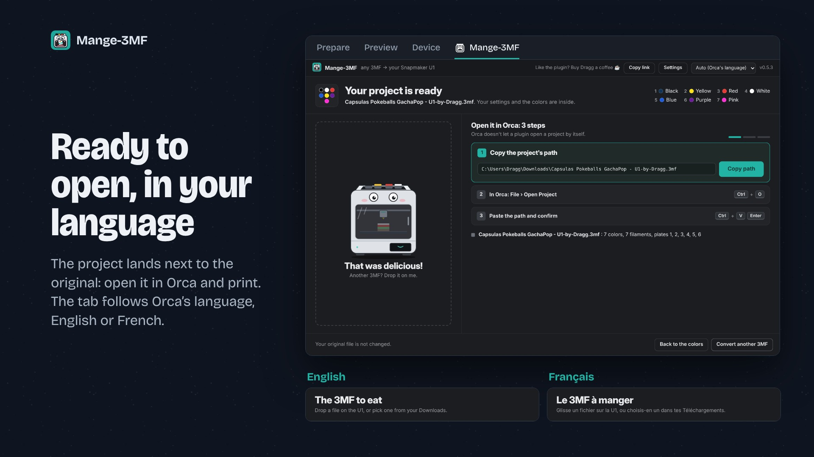

  
  
  
  
  
  

<b>Opened a MakerWorld model in OrcaSlicer for your U1 and lost the colors? Mange-3MF brings them back: one filament per color, with your own settings.</b>

📖 <a href="GUIDE.md"><b>Full user guide</b></a> &nbsp;·&nbsp; 🇫🇷 <a href="LISEZMOI.md">Mode d'emploi complet en français</a>

---

## 😩 The problem

Open a 3MF made with another slicer (Bambu Studio for MakerWorld, Snapmaker Orca…) in OrcaSlicer 2.5 for the U1: the parts arrive, the colors don't.

- Orca swaps the author's filaments for its defaults: 4 slots, often 4 × "Generic ABS" of the same color;
- a 7-color project loses the painting of colors 5 to 7;
- the nozzle and the plate change, and parts can jump to another plate or off the bed.

## ✨ What Mange-3MF does

It adds a **Mange-3MF** tab to OrcaSlicer, and the U1 waits for you beside the plate in Prepare. Open or drop a 3MF and you get a real OrcaSlicer project for the U1:

- 🎨 **Exactly the model's colors**: one file, one filament per color. 7 colors give 7 filaments, nothing split or merged.
- 🖌️ **Everything kept**: painting, per-object and per-part colors, modifiers, layer ranges, per-layer color changes, per-feature filaments, plates and their names.
- ⚙️ **Your settings**: printer, High flow / Standard nozzles, process and plate, saved once from your Orca and shown like on the printer, one card per head. Nothing comes from the author's settings.
- 🧵 **Your filament presets**: each color gets the closest of your profiles in the same material, or any of your Orca filament presets, which Orca recognizes when it opens the project: no more "…(project.3mf)" copies. One profile can serve several colors: each filament keeps the model's color.
- ➕ **Extra colors**: add filaments the model doesn't use, ready to paint or recolor a part in Orca.
- 🎯 **Your call**: change a filament's color in a click, and choose where the converted files go.
- 🌍 **English or French**: the tab follows Orca's language, or pick one at the top right.
- 🖥️ **A clean tab**, in the same style as multiACE Bridge: home, analysis, file ready, and a Settings window.
- 🍽️ **Right there in Prepare**: open a 3MF that isn't set up for the U1 and she shows up beside the plate, offers to eat it, lets you pick colors and profiles, and converts it on the spot. Prefer a notification, or nothing? One setting.
- 😋 **A hungry U1**: drop a 3MF on the tab and the U1 swallows it, chews during the analysis, then burps the model's colors. Converted files are signed `… - U1-by-Dragg.3mf`.

## 🚀 Quick start

**Install**

- **Orca Cloud** (easiest, with updates): in Orca's **Plugins** window, find "Mange-3MF (Snapmaker U1)" in Orca Cloud and subscribe.
- **By hand**: download `mange_3mf_any.py` from the [latest release](../../releases/latest), then in Orca: **Plugins › Install a plugin › Install local plugin**. Accept the permissions (your **Downloads** folder, background threads). To update, install the new file the same way.

**Use**

1. Set Orca to your usual U1 settings once, then in the tab click **Settings › Save Orca's current settings**.
2. Open the 3MF in Orca: the U1 shows up beside the plate; click **Eat it**. Or drop it on the tab, or click **Analyze** next to a file of your Downloads.
3. Check the colors and profiles, click **Convert**, then **Copy path**, **File › Open Project (Ctrl+O)**, paste and confirm.

Everything else (what is kept, limits, troubleshooting) is in the **[full user guide](GUIDE.md)**.

  
  

## 🌈 More than 4 colors

Orca accepts more filaments than heads on the U1 and assigns the heads when slicing. Above 4 filaments the G-code also uses `T4`, `T5`…: your printer needs something to handle them, like the **multiACE** virtual toolheads. No multiACE? Tick **One file per plate**: each file only has its plate's colors.

Orca keeps at least 4 filaments on the U1 (one per head) and can paint 16 filaments at most.

## 🧪 Status

Beta **0.5.3** (the U1 in Prepare). 437 automated checks outside Orca (`python tests/run_all.py`; two sample 3MFs are needed and are not published, see [tests/samples/PROVENANCE.md](tests/samples/PROVENANCE.md)). The tab, the analysis, the 0.5.0 interface and the Prepare panel have run in OrcaSlicer 2.5.1. PrusaSlicer files are not supported yet; already-sliced `.gcode.3mf` files are refused. Full history in [CHANGELOG.md](CHANGELOG.md) (French).

## 🌍 Translations

Every text of the plugin and of the tab lives in one table, `TEXTS`, at the top of `mange_3mf_any.py`. To add your language, copy the `"en"` block, translate each text (keep the `{0}`, `{1}`… placeholders and the HTML) and open a pull request. `tests/test_lang.py` checks that nothing is missing.

## 🐞 Bugs & ideas

Open an [issue](../../issues/new/choose) with your plugin and Orca versions, a link to the model page and a screenshot of the tab or the panel. English or French.

## ☕ Support

Mange-3MF is free. If it saves you time, you can [buy Dragg a coffee on Ko-fi](https://ko-fi.com/dragg). The **Copy link** button is also at the top of the tab.

## 🔒 Privacy

The plugin lists the 3MF files of your Downloads folder, reads the file you pick and writes the converted project next to it. It keeps your saved settings and your choices (language, output folder, panel) in its own storage folder. No network access, nothing collected.

## ⚠️ Disclaimer / Avertissement

Beta software provided **as is, without any warranty** (GPL-3.0). **Use at your own risk**: always check the converted project before printing; the author cannot be held liable for any damage to the printer or the prints.
Bêta fournie **telle quelle, sans garantie**. **À vos risques et périls** : vérifie toujours le projet converti avant d'imprimer.

## 🙏 Credits

- The **OrcaSlicer** team, for the plugin system.
- **decay71** and the multiACE contributors, for printing more than 4 colors on the U1: [decay71/multiACE](https://github.com/decay71/multiACE).

Made by Dragg with his friend Claude. License: GPL-3.0.
