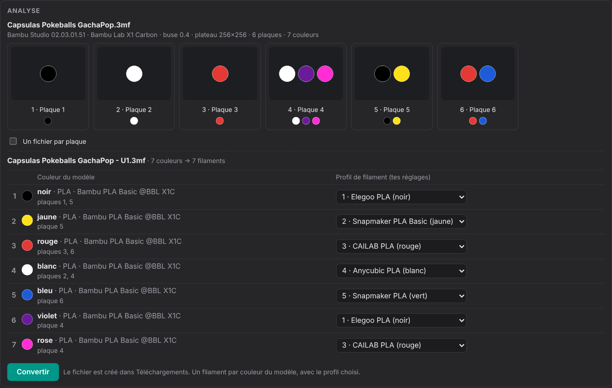

# Mange-3MF (Snapmaker U1) — OrcaSlicer plugin

**Eats any 3MF and spits out an OrcaSlicer project ready for your Snapmaker U1.**
MakerWorld / Bambu Studio, Snapmaker Orca, OrcaSlicer and its forks: exactly the model's colours (one filament per colour), the painting and the plates are kept, with **your** own settings.

> 🇫🇷 **Mode d'emploi complet en français : [LISEZMOI.md](LISEZMOI.md).** The interface is in French for now.

- Version **0.2.1** — see [CHANGELOG.md](CHANGELOG.md) (French)
- For OrcaSlicer 2.5 (Python plugins) and the Snapmaker U1 (4-head profile)
- By Dragg with his friend Claude — GPL-3.0
- Community plugin, not affiliated with Snapmaker, Bambu Lab or OrcaSlicer. **Use at your own risk.**

## The problem

Open a 3MF made with another slicer (Bambu Studio for MakerWorld, Snapmaker Orca…) in OrcaSlicer 2.5 for the U1: the parts arrive, but not the colours or the settings.

- Orca replaces the author's filaments with its defaults: 4 slots (one per head), for example 4 × "Generic ABS" of the same colour;
- a 7-colour project loses the painting of colours 5 to 7;
- the printer, nozzle and plate change too (0.2 nozzle, Cool Plate…);
- parts can move to another plate or off the bed.

## What it does

Mange-3MF adds a **Mange-3MF tab** to OrcaSlicer. It reads the original 3MF itself and builds a real OrcaSlicer project:

- **exactly the model's colours**: one file with all the plates and **one filament per colour** (7 colours → 7 filaments). Nothing is split into several files, no colour is merged;
- **colours kept**: per-object and per-part filaments, painting (renumbered), modifiers, layer ranges, per-layer colour / tool changes, per-feature filaments (walls, infill, supports…);
- **plates kept**: same plates, names and parts, placed on the U1 bed;
- **your settings**: printer, High Flow / Standard nozzles, process (with the multiACE step), plate type, memorised in one click. Nothing is taken from the author's settings;
- **filament profiles**: each colour gets one of your profiles, same material and nearest colour, with its High Flow and Standard values. You can pick another one in the tab;
- the converted file is written next to the original (`Model - U1.3mf`); open it with **File › Open project (Ctrl+O)**.

## Install

- **Orca Cloud** (easiest, with updates): in Orca's **Plugins** window, look for "Mange-3MF (Snapmaker U1)" in Orca Cloud and subscribe.
- **Manually**: download `mange_3mf_any.py` from the [latest release](../../releases/latest), then in Orca: **Plugins › Install a plugin › Install local plugin** and choose the file. Accept the permissions: read/write in your **Downloads** folder, background threads.

The **Mange-3MF** tab appears at the end of the tab bar.

## Use

1. **Once**: set Orca to your usual U1 settings (open one of your U1 projects, or File › New project and pick your filaments), then click **« Mémoriser les réglages actuels d'Orca »** in the tab.
2. **Drop a 3MF** on the tab, or click **« Analyser »** next to a file of your Downloads, or paste its path. Opening a foreign 3MF in Orca also shows a notification that prepares the analysis in the tab.
3. **Check the analysis** at the top of the tab: one filament per colour, the profile used for each one.
4. Click **« Convertir »**, then **« Copier le chemin »** and open the project with Ctrl+O.

## More than 4 colours

Orca accepts more filaments than heads on the U1 and assigns the heads when slicing. Above 4 filaments the G-code also uses `T4`, `T5`…: your printer must handle them, for example with the **multiACE** virtual toolheads. Otherwise tick **« Un fichier par plaque »** (one file per plate, with only that plate's colours).

Orca keeps at least 4 filaments on the U1 (one per head) and can only paint 16 filaments.

## Status

Beta 0.2.1. Automated tests outside Orca: 197 checks (`python tests/run_all.py`; two sample 3MFs are needed and are not included, see [tests/samples/PROVENANCE.md](tests/samples/PROVENANCE.md)). First runs in OrcaSlicer 2.5.1. PrusaSlicer files are not supported yet; already-sliced `.gcode.3mf` files are refused.

## Bugs & feedback

Open an [issue](../../issues/new/choose) with your plugin and Orca versions, where the 3MF comes from (link to the model page rather than someone else's file) and a screenshot of the tab. En français ou en anglais.

## Privacy

The plugin lists the 3MF files of your Downloads folder, reads the file you choose and writes the converted file next to it. No network access.

## ⚠️ Disclaimer / Avertissement

Beta software provided **as is, without any warranty** (GPL-3.0). **Use at your own risk**: always check the converted project before printing; the author cannot be held liable for any damage to the printer or the prints.
Bêta fournie **telle quelle, sans garantie**. **À vos risques et périls** : vérifie toujours le projet converti avant d'imprimer.

## Credits

- The **OrcaSlicer** team for the plugin system.
- **decay71** and the multiACE contributors, for printing more than 4 colours on the U1: [decay71/multiACE](https://github.com/decay71/multiACE).

License: GPL-3.0 — Dragg with his friend Claude
