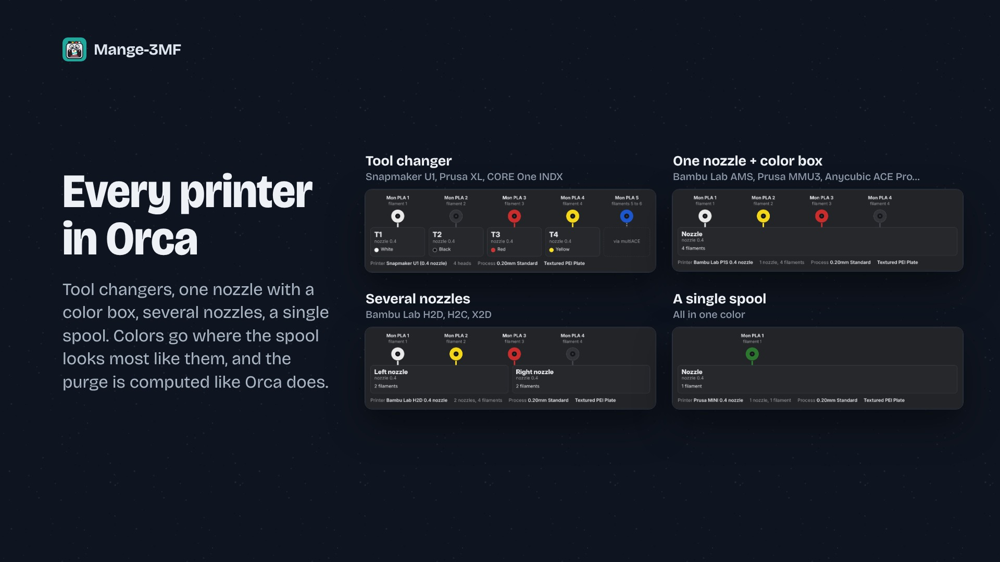
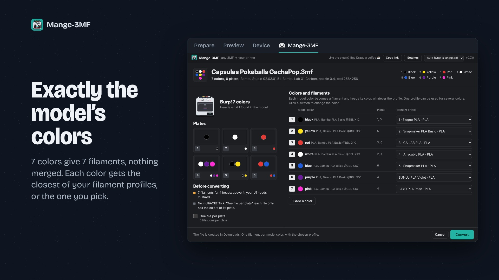
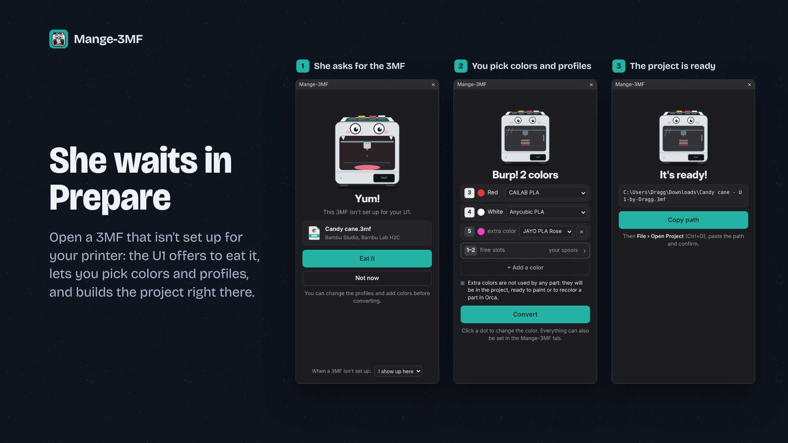
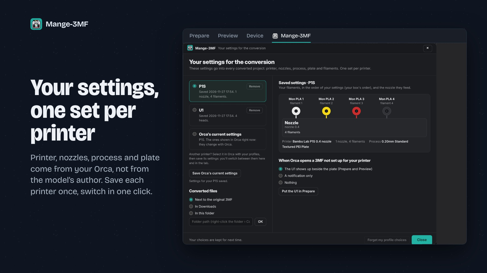

  
  
  
  
  
  

<b>Opened a MakerWorld or Printables model in OrcaSlicer and lost the colors, or got the author's printer and filaments? Mange-3MF brings it back for your printer: one filament per color, with your own settings.</b>

📖 <a href="GUIDE.md"><b>Full user guide</b></a> &nbsp;·&nbsp; 🇫🇷 <a href="LISEZMOI.md">Mode d'emploi complet en français</a>

---

## 😩 The problem

Open a 3MF made with another slicer or for another printer (Bambu Studio for MakerWorld, PrusaSlicer for Printables, Snapmaker Orca…) in OrcaSlicer 2.5: the parts arrive, your colors and settings don't.

- On a tool changer like the Snapmaker U1, Orca swaps the author's filaments for its defaults: 4 slots, often 4 × "Generic ABS" of the same color, and a 7-color project loses the painting of colors 5 to 7.
- On a Bambu Lab, Prusa, Anycubic or Elegoo, the author's printer, process and filaments come with the model, and you set everything again by hand.
- The nozzle and the plate change, and parts can jump to another plate or off the bed.

## ✨ What Mange-3MF does

It adds a **Mange-3MF** tab to OrcaSlicer, and the U1, our mascot, waits for you beside the plate in Prepare. Open or drop a 3MF and you get a real OrcaSlicer project for your printer:

- 🖨️ **Every printer in Orca**: tool changers (Snapmaker U1, Prusa XL, CORE One INDX), one nozzle with a color box (Bambu Lab AMS, Prusa MMU3, Anycubic ACE Pro, Elegoo, Creality, Qidi…), several nozzles (Bambu Lab H2D, H2C, X2D), or a single spool. Your settings are saved per printer: switch between them in one click.
- 🎨 **Exactly the model's colors**: one file, one filament per color. 7 colors give 7 filaments, nothing split or merged. Each color goes to the head or the box slot whose spool looks most like it.
- 🖌️ **Everything kept**: painting, per-object and per-part colors, modifiers, layer ranges, per-layer color changes, per-feature filaments, plates and their names.
- ⚙️ **Your settings**: printer, nozzles, process and plate, saved once from your Orca and shown like on the printer: one card per head, or your spools and the nozzle they feed. Nothing comes from the author's settings.
- 🧮 **Purge like Orca**: on a one-nozzle printer, the purge between colors is computed from the model's colors, the way Orca does it when you change a color.
- 🧵 **Your filament presets**: each color gets the closest of your profiles in the same material, or any of your Orca filament presets, which Orca recognizes when it opens the project. One profile can serve several colors: each filament keeps the model's color.
- 🧪 **Orca's system presets too**: besides your own profiles, each color's list offers the system presets Orca shows for your printer, grouped by brand. When none of your profiles has the model's material (PETG…), the best one is picked for you, with a warning to check it.
- 1️⃣ **All in one color**: a single spool? One tick puts every part and the painting on your filament.
- 🧩 **PrusaSlicer and Printables projects too**: parts, modifiers, painting, per-layer color changes and layer ranges come along. Plain 3MFs from CAD tools keep their colors.
- 🧠 **Your choices remembered**: pick another profile for a color once, it comes back next time for the same color and material.
- 🛟 **The author's supports, your call**: one tick keeps the author's supports (type, support filament); otherwise your settings decide.
- ➕ **Extra colors**: add filaments the model doesn't use, ready to paint or recolor a part in Orca.
- 🌍 **5 languages**: English, French, German, Spanish and Italian. The tab follows Orca's language, or pick one at the top right.
- 🍽️ **Right there in Prepare**: open a 3MF that isn't set up for your printer and the U1 shows up beside the plate, offers to eat it, lets you pick colors and profiles, and converts it on the spot. Prefer a notification, or nothing? One setting.
- 😋 **A hungry U1**: drop a 3MF on the tab and she swallows it, chews during the analysis, then burps the model's colors. Converted files are signed with your printer's name: `… - P1S-by-Dragg.3mf`, `… - U1-by-Dragg.3mf`.

## 🚀 Quick start

**Install**

- **Orca Cloud** (easiest, with updates): in Orca's **Plugins** window, find "Mange-3MF" in Orca Cloud and subscribe.
- **By hand**: download `mange_3mf_any.py` from the [latest release](../../releases/latest), then in Orca: **Plugins › Install a plugin › Install local plugin**. Accept the permissions (your **Downloads** folder, background threads). To update, install the new file the same way.

**Use**

1. Set Orca to your printer and your usual settings once, then in the tab click **Settings › Save Orca's current settings**. Another printer? Do the same with it, then pick the one you print on next to **For** in the tab.
2. Open the 3MF in Orca: the U1 shows up beside the plate; click **Eat it**. Or drop it on the tab, or click **Analyze** next to a file of your Downloads.
3. Check the colors and profiles, click **Convert**, then **Copy path**, **File › Open Project (Ctrl+O)**, paste and confirm.

Everything else (what is kept, limits, troubleshooting) is in the **[full user guide](GUIDE.md)**.

  
  

## 🌈 More colors than your printer holds

The converted project has one filament per color, even when your printer holds fewer at a time; the tab tells you:

- **Snapmaker U1**: above 4 filaments the G-code also uses `T4`, `T5`…: the **multiACE** virtual toolheads handle them. No multiACE? Tick **One file per plate**: each file only has its plate's colors.
- **Other tool changers** (Prusa XL, CORE One INDX): one filament per head; tick **One file per plate** if each plate fits.
- **One nozzle with a box** (AMS, MMU3, ACE Pro…): as many colors as the slots in your settings; load more spools (one more box) or split by plate.
- **A single spool**: tick **All in one color**, or swap spools during the print.

On a tool changer, Orca keeps at least one filament per head, and it can paint 16 filaments at most.

## 🧪 Status

Beta **0.7.0**: every printer in Orca, settings saved per printer, purge like Orca, All in one color. 640 automated checks outside Orca (`python tests/run_all.py`; two sample 3MFs are needed and are not published, see [tests/samples/PROVENANCE.md](tests/samples/PROVENANCE.md)), with the real printer profiles of 33 printers from Orca (Bambu Lab, Prusa, Anycubic, Elegoo, Creality, Qidi, Snapmaker), plus the tab and the Prepare panel rendered in Chrome. Earlier versions have run in a real Orca 2.5.1 for the U1; for other printers, feedback is welcome. The Bambu Lab H3C and P3C are ready for the day Orca has their profiles (not yet in Orca 2.5.1). Resin (SLA) projects and already-sliced files (`.gcode.3mf`, `.bgcode`) are refused. Full history in [CHANGELOG.md](CHANGELOG.md) (French).

## 🌍 Translations

Every text of the plugin and of the tab lives in one table, `TEXTS`, at the top of `mange_3mf_any.py`. English, French, German, Spanish and Italian are in; corrections are welcome. To add your language, copy the `"en"` block, translate each text (keep the `{0}`, `{1}`… placeholders and the HTML) and open a pull request. `tests/test_lang.py` checks that nothing is missing.

## 🐞 Bugs & ideas

Open an [issue](../../issues/new/choose) with your plugin and Orca versions, your printer, a link to the model page and a screenshot of the tab or the panel. English or French.

## ☕ Support

Mange-3MF is free. If it saves you time, you can [buy Dragg a coffee on Ko-fi](https://ko-fi.com/dragg). The **Copy link** button is also at the top of the tab.

## 🔒 Privacy

The plugin lists the 3MF files of your Downloads folder, reads the file you pick and writes the converted project next to it. It keeps your saved settings and your choices (language, output folder, panel) in its own storage folder. No network access, nothing collected.

## ⚠️ Disclaimer / Avertissement

Beta software provided **as is, without any warranty** (GPL-3.0). **Use at your own risk**: always check the converted project before printing; the author cannot be held liable for any damage to the printer or the prints.
Bêta fournie **telle quelle, sans garantie**. **À vos risques et périls** : vérifie toujours le projet converti avant d'imprimer.

## 🙏 Credits

- The **OrcaSlicer** team, for the plugin system and the printer profiles.
- **decay71** and the multiACE contributors, for printing more than 4 colors on the U1: [decay71/multiACE](https://github.com/decay71/multiACE).

Made by Dragg with his friend Claude. License: GPL-3.0.
